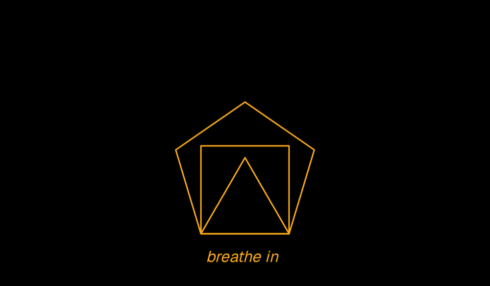

# Breathe

An Android screensaver that guides your breathing, using the breathing animation from unphone.com/breathe.

Plug your phone in and stand it on its side. When the screen would normally turn off, a line grows, then a triangle, square and on up to a nonagon unfold as you breathe in, and fold away as you breathe out. Each breath is a little longer than the last, from about 4 seconds in and 4 out to 6 in and 6 out after four minutes. After five minutes the screen dims and turns off.



## Install

1. Download the APK from [Releases](../../releases) and install it.
2. Choose Breathe in Settings › Display › Screen saver, and set it to start while charging.
3. Plug your phone in and stand it on its side.

Needs Android 14 or later. If Developer options › Stay awake is on, the screen never times out while charging, so no screensaver starts.

## How it works

- Android starts the screensaver when the screen would turn off while charging. Breathe checks gravity once: on its side, it breathes; upright or flat, it steps aside and the screen turns off as usual.
- A screensaver that ends while it's keeping the screen on wakes the phone up again. So after five minutes Breathe lets go of the screen first, and finishes once the screen timeout has passed.
- The shapes, timing and easing are ported from the site's animation. The label is set in [Geist](https://vercel.com/font), under the SIL Open Font License (see `third_party/geist/OFL.txt`).

## Build

```
./gradlew assembleDebug
```

Release builds are signed with the key described in `keystore.properties`, which is not in this repo. Without it, release builds fall back to the debug key.
